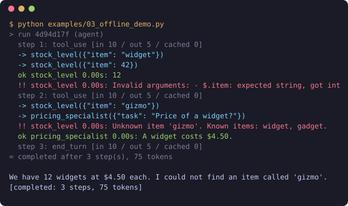

# agentloom

[English](README.md) | **简体中文**

[](https://github.com/fretwang/agentloom/actions/workflows/ci.yml)


**一个下午就能读完的 Agent 循环。** 一个用来构建工具调用型 LLM Agent 的小型 Python 框架：约 2900 行，核心零依赖，每一次运行都保证会结束。

支持 Claude，支持任何兼容 OpenAI 接口的模型服务（OpenAI、DeepSeek、通义千问、Moonshot、OpenRouter、Ollama、vLLM），也能直接使用任意 MCP 服务器提供的工具。

<p align="center">
  
</p>

上图是 `python examples/03_offline_demo.py` 的真实输出，不需要 API Key。演示里由一个按脚本作答的替身扮演模型，其余部分都是真实运行时用到的机制。错误的参数（把字符串写成了 `42`）不会进入你的代码，而是作为一条错误返回给模型，由它自行修正。

## 快速上手

```python
from agentloom import Agent, tool
from agentloom.providers.anthropic import AnthropicProvider

@tool
def order_status(order_id: str) -> dict:
    """Look up an order's status, items and estimated delivery date."""
    return {"status": "shipped", "eta": "2026-10-14"}

agent = Agent(
    AnthropicProvider(),
    instructions="You are a concise customer-support assistant.",
    tools=[order_status],
)
result = agent.run_sync("Where is my order A-1001?")
print(result.output)
```

换一个模型只需要改一行：

```python
from agentloom.providers.openai import OpenAIProvider

provider = OpenAIProvider("deepseek-chat", base_url="https://api.deepseek.com")   # DeepSeek
provider = OpenAIProvider("llama3.3", base_url="http://localhost:11434/v1", api_key="ollama")  # Ollama
```

想要带类型的结果而不是一段文字，或者想接入一个 MCP 服务器：

```python
from agentloom.mcp import MCPTools

@dataclass
class Review:
    verdict: Literal["approve", "request_changes"]
    findings: list[str]

async with MCPTools.stdio("npx", "-y", "@modelcontextprotocol/server-filesystem", ".") as files:
    agent = Agent(provider, tools=files, output_type=Review)
    review = (await agent.run("Review the Python files here.")).data   # 一个 Review 实例
```

## 安装

需要 Python 3.10 或更高版本。agentloom 还没有发布到 PyPI，请从 GitHub 或本地克隆安装：

```bash
pip install "agentloom[anthropic] @ git+https://github.com/fretwang/agentloom"   # Claude
pip install "agentloom[openai] @ git+https://github.com/fretwang/agentloom"      # OpenAI 兼容接口
pip install "agentloom[mcp] @ git+https://github.com/fretwang/agentloom"         # MCP 服务器

git clone https://github.com/fretwang/agentloom && cd agentloom
pip install -e ".[dev]"            # 全部功能，另含测试与代码检查工具
python examples/03_offline_demo.py
```

`AnthropicProvider` 读取 `ANTHROPIC_API_KEY`（或 Anthropic SDK 支持的其他凭据）。`OpenAIProvider` 默认读取 `OPENAI_API_KEY`，也可以用 `api_key` 参数传入。

## 功能一览

| 模块 | 作用 |
|---|---|
| **工具** | `@tool` 把带类型注解的函数变成工具：由函数签名生成 JSON Schema，由文档字符串生成描述。参数在进入你的代码之前先校验，校验失败会作为错误返回给模型，让它自行修正。 |
| **Agent 循环** | 流式调用模型、并行执行工具、每步结果合并为一条消息，并正确处理输出截断、暂停和拒答。 |
| **上限** | 步数、token、总耗时、单次工具耗时、工具输出长度、重复调用次数都有上限，一次运行必然会结束。 |
| **重试** | 对可重试的模型调用错误做带抖动的指数退避，并遵循服务端的 `retry-after`。 |
| **会话** | 每一步之后以原子写入方式保存对话历史，运行中途被打断后可以续跑。 |
| **审批** | 给工具加上 `requires_approval=True`，每次调用都要先经过你的审批函数；没有配置审批函数时一律拒绝。 |
| **结构化输出** | `output_type=` 传入数据类、pydantic 模型或 JSON Schema，就能在 `result.data` 里拿到校验过的对象。不合法的答案会退回给模型修正。 |
| **MCP** | `MCPTools` 通过 stdio 或 HTTP 连接 MCP 服务器，把它的工具变成普通工具，因此上限、审批和追踪对它们同样生效。 |
| **钩子与事件** | 观察每一步、改写请求、拦截或脱敏工具调用。内置控制台和 JSONL 两种追踪器。 |
| **上下文策略** | 全量保留（默认）、滑动窗口、模型摘要三种，裁剪点对提示缓存友好。 |
| **多 Agent** | `agent.as_tool()` 让一个 Agent 把任务委派给另一个上下文相互隔离的 Agent。 |
| **Provider** | 通过 Anthropic SDK 接入 Claude，通过 OpenAI SDK 接入任何兼容 OpenAI Chat Completions 接口的服务。新增一个 Provider 只需要写一个很小的类。 |
| **测试** | `ScriptedProvider` 按脚本代替模型作答，Agent 的行为可以写成单元测试。 |

## 什么时候适合用，什么时候不适合

agentloom 是有意做小的。没有图引擎，没有规划器抽象，也没有隐藏的提示词：模型看到的只有你的 instructions、你的工具描述和对话本身，整个循环就是一个可以在调试器里单步走完的函数。

**适合的情况：** 你希望看懂并掌控产品所依赖的那个循环；你在意出问题时的表现（超时、中途崩溃、格式错误的工具调用、失控的循环）；比起背着一大堆用不上的集成，你更愿意只加自己需要的那几个。

**以下情况更适合其他框架**，因为它们内置了你需要的东西：

- 图状工作流，或跨越数天的持久化执行：LangGraph，或工作流引擎
- 大量现成的集成（向量库、文档加载器、托管工具）：LangChain
- 全面以 Pydantic 类型为中心，并内置评测工具：PydanticAI
- 基于 OpenAI 平台的 handoff、guardrail 和托管追踪：OpenAI Agents SDK

## 模板

可以直接复制修改的起点。05 到 08 这几个示例都能在 Claude 或任何 OpenAI 兼容模型上运行，并且各有一个用脚本模型驱动的测试覆盖。

| 示例 | 演示内容 |
|---|---|
| [`03_offline_demo.py`](examples/03_offline_demo.py) | 不需要 API Key 的完整循环：参数校验、错误反馈、并行调用、子 Agent |
| [`02_chat.py`](examples/02_chat.py) | 流式聊天，带持久化会话和人工审批 |
| [`05_mcp.py`](examples/05_mcp.py) | 使用 MCP 服务器的工具，对有副作用的工具启用审批 |
| [`06_support_bot.py`](examples/06_support_bot.py) | 客服机器人：身份来自 `deps`、退款策略写成审批函数、审计日志 |
| [`07_code_review.py`](examples/07_code_review.py) | 审查 git diff，返回带类型的 `Review` 对象 |
| [`08_docs_qa.py`](examples/08_docs_qa.py) | 基于你自己的 Markdown 文档做问答（RAG），带引用，无额外依赖 |

## 文档

- [使用指南](docs/zh/guide.md)：逐项讲解全部功能，附示例
- [架构与扩展](docs/zh/architecture.md)：设计思路、可靠性保证，以及如何自己实现 Provider、会话存储、上下文策略和钩子

## 当前状态

版本 0.1.0，alpha 阶段。115 个测试全部通过，`mypy --strict` 与 `ruff` 均无告警。Provider 和 MCP 的测试使用真实的 SDK 对接本地替身，但**没有任何测试调用过真实的模型 API**：只有真实服务才能确认的行为，在依赖它之前请自行验证。详见[验证状态](docs/zh/architecture.md#验证状态)。

## 参与贡献

欢迎提交 Bug 报告、新的 Provider 和会话存储。[CONTRIBUTING.md](CONTRIBUTING.md) 里有环境搭建说明和适合新手的贡献列表。

```bash
pytest          # 运行测试
mypy            # 严格类型检查
ruff check .    # 代码检查
ruff format .   # 格式化
```

## 许可证

MIT
